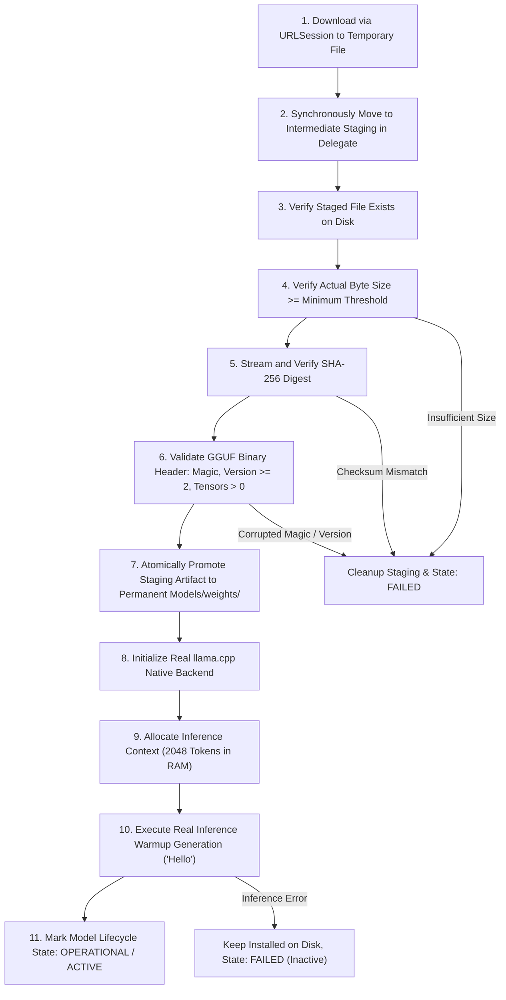

# IRIS-I — Background Execution Reality, Transactional Model Lifecycle & Intent Architecture

**Document Version:** 2.1.0  
**Target Hardware:** Apple A19 (`Chanakya's iPhone` `00008150-00116C391A13401C`)  
**Operating System:** iOS 18.0+ / Xcode 15+  
**Target Architecture:** `arm64` (Physical Device) / `arm64-apple-ios-simulator`  

---

## 1. Requirement A: Transactional Model Download & Activation Lifecycle

Model installation is strictly transactional. A file on disk is not assumed to be functional without end-to-end cryptographic and runtime verification.



### Discrete Lifecycle States (`ModelLifecycleState`)

To prevent ambiguous UI representation, IRIS-I separates model states into 11 distinct phases:

| State | Physical Storage State | Memory Residency | Operational Status |
| :--- | :--- | :--- | :--- |
| `uninstalled` | None | None | Inactive |
| `downloading(progress, written, total, speed)` | In-transit in `URLSession` | None | Network active |
| `staged(fileURL, fileSize)` | File in `Models/staging/` | None | Awaiting integrity checks |
| `validating(step)` | File in `Models/staging/` | CPU SHA-256 stream | Cryptographic verification |
| `installed(fileURL, fileSize)` | Atomically promoted to `Models/weights/` | None | Valid GGUF on disk; not loaded |
| `loading(progress)` | File in `Models/weights/` | Allocating native memory | Initializing llama backend |
| `loaded(contextSize)` | File in `Models/weights/` | Context allocated in RAM | Metal context allocated; warming up |
| `operational(contextSize)` | File in `Models/weights/` | Resident in unified memory | Verified functional via warmup prompt |
| `inferring(promptSnippet)` | File in `Models/weights/` | Active compute on Metal GPU | Generating tokens |
| `unloading` | File in `Models/weights/` | Deallocating context | Releasing native pointers |
| `failed(stage, error)` | Cleaned from staging (or preserved on disk) | None | Truthful error details displayed |

---

## 2. Requirement B: Layered Intent Understanding Architecture

IRIS-I abandons hardcoded string expansion in favor of a 7-stage layered execution pipeline:

```mermaid
flowchart LR
    Prompt["User Voice / Text Prompt"] --> Layer1["Tier 1: Fast Intent Router (<10ms)"]
    Layer1 -- "Matched Direct System Intent" --> ToolExec["Direct Tool Execution"]
    Layer1 -- "Unmatched / Complex Query" --> Preflight["Local Neural Model Preflight"]
    Preflight -- "Model Not Operational" --> Guidance["Spoken Guidance & Honest Status"]
    Preflight -- "Model Operational" --> ReAct["Tier 2: Multi-Step ReAct Loop"]
    ReAct --> ToolCall["Structured Tool Selection & Schema Validation"]
    ToolCall --> PolicyGate["PermissionManager Security Gate"]
    PolicyGate -- "Approved" --> ToolExec
    PolicyGate -- "High Impact" --> Confirmation["User Confirmation Ticket"]
    ToolExec --> Verification["Result Verification & Outcome Classification"]
    Verification --> Record["Structured ExecutionRecord Generation"]
    Record --> Synthesis["Truthful Natural-Language Response Synthesis"]
```



### The 7 Layers:
1. **Tier 1 Fast Deterministic Router (<10ms)**: Direct hash-map matching for fundamental system queries (`time`, `date`, `battery`, `hardware telemetry`, `greetings`, `capabilities`, `direct verified app launches`).
2. **Local LLM Intent Extraction**: Active on-device neural model (`Qwen 2.5 3B GGUF` on Metal) extracts structured intents for multi-clause or open-ended requests.
3. **Structured Tool Selection**: Tool parameters validated against JSON Schema via `ToolParameterSchema`.
4. **Permission & Security Gates**: `PermissionManager` enforces `destructive` and `write` policy checks (requiring confirmation tickets for email/SMS transmission or calendar deletions).
5. **Tool Execution**: Executes strictly through documented iOS public frameworks (`EventKit`, `AppLaunchRegistry`, `SystemInfoTool`).
6. **Result Verification**: Validates whether the operation produced a verifiable native artifact (e.g., Event ID in calendar) or was handed off externally (`canOpenURL` launch).
7. **Natural-Language Response Generation**: Honest synthesis reflecting whether the action was `.completedVerified`, `.completedUnverified`, or `.failed`.

---

## 3. Requirement C: Real Dynamic Island & Live Activity Constraints

IRIS-I implements genuine `ActivityKit` and `WidgetKit` presentations respecting Apple's strict hardware boundaries on the physical iPhone:

### Hardware Geometry & Layout Budget

| Presentation Mode | Horizontal Budget | Vertical Budget | Rendered Elements | Layout Compliance |
| :--- | :--- | :--- | :--- | :--- |
| **Compact Leading** | $\le 52\,\text{pt}$ | $36.6\,\text{pt}$ | 3D Pearlescent Orb ($20\,\text{pt}$) | **Within Budget** (prevents iOS fallback to app icon) |
| **Compact Trailing** | $\le 52\,\text{pt}$ | $36.6\,\text{pt}$ | 4-bar mini waveform ($12\,\text{pt}$) or mic badge ($18\,\text{pt}$) | **Within Budget** |
| **Minimal Mode** | Circular ($\sim 24\,\text{pt}$) | $24\,\text{pt}$ | Mini pearl orb ($14\,\text{pt}$) | **Compliant** |
| **Expanded Leading** | Flexible ($120\,\text{pt}$) | $64\,\text{pt}$ | 3D Pearlescent Orb ($32\,\text{pt}$) + `"Hey IRIS"` headline + status subtitle | **Full Design Match** |
| **Expanded Trailing** | Flexible ($110\,\text{pt}$) | $64\,\text{pt}$ | 7-bar audio waveform ($20\,\text{pt}$) + green mic status badge ($28\,\text{pt}$) | **Full Design Match** |
| **Expanded Bottom** | Full width ($340\,\text{pt}$) | Variable | Live transcribed text or execution result | **Full Design Match** |
| **Lock Screen Banner** | Full width ($360\,\text{pt}$) | $68\,\text{pt}$ | Complete status capsule matching Dynamic Island aesthetic | **Full Design Match** |

> [!IMPORTANT]
> The microphone badge inside the Dynamic Island is a **state indicator**, not an unrestricted background recording trigger. Apple's sandbox prevents widgets and Live Activities from directly activating `AVAudioEngine` recording while suspended.

---

## 4. Requirement D: Action Button & App Intents

- **Parameterless `StartListeningIntent` and `AskIRISIntent`**:
  ```swift
  public struct StartListeningIntent: AppIntent {
      public static var title: LocalizedStringResource = "Start Iris Voice Agent"
      public static var description = IntentDescription("Wakes IRIS and immediately begins listening for voice commands in the Dynamic Island.")
      public static var openAppWhenRun: Bool = false
      public static var isDiscoverable: Bool = true
      ...
  }
  ```
  - **No parameters**: Eliminates the modal text prompt dialog ("What can IRIS do for you?").
  - **Execution Behavior**: Immediately calls `IRISDynamicIslandManager.shared.startLiveActivity()` with `AlertConfiguration(title:body:sound:)` to expand the real Dynamic Island.
  - **Context-Aware Audio Capture**: Checks whether the app process can legitimately record. If running in background where iOS blocks audio capture, sets Live Activity status to `"Tap to Speak"` and transitions to foreground on user tap.

---

## 5. Requirement E: Background Execution Reality Matrix

The table below documents the physical and architectural capabilities of IRIS-I across all iOS application execution states:

| iOS Execution State | Live Activity Updates | App Intent Execution | Background Audio Playback | Microphone Capture | Local Model Inference | Wake-Word Detection | Shortcuts Execution |
| :--- | :--- | :--- | :--- | :--- | :--- | :--- | :--- |
| **Foreground (Active)** | ✅ Full | ✅ Full | ✅ Full | ✅ Full | ✅ Full (Metal GPU) | ✅ Full | ✅ Full |
| **Foreground (Inactive)** | ✅ Full | ✅ Full | ✅ Full | ⚠️ Throttled | ⚠️ Throttled | ⚠️ Throttled | ✅ Full |
| **Background (Active Audio)** | ✅ Full | ⚠️ Time-bounded | ✅ Supported | ⚠️ Continuous only if started in foreground | ⚠️ CPU/NE only, risk of jetsam | ⚠️ Continuous only if audio session active | ✅ Full |
| **Background (Suspended)** | ⚠️ Push/AppIntent only | ⚠️ Out-of-process | ❌ Unsupported | ❌ Blocked by iOS sandbox | ❌ Suspended | ❌ Blocked | ⚠️ Out-of-process |
| **Lock Screen** | ✅ Full | ⚠️ Wakes extension | ✅ If audio active | ❌ Requires unlock/foreground | ⚠️ Bounded by memory ceiling | ⚠️ If audio active | ⚠️ Wakes extension |
| **Terminated** | ❌ Unsupported | ⚠️ Starts process | ❌ Unsupported | ❌ Blocked | ❌ Cold boot required | ❌ Blocked | ⚠️ Starts process |

---

## 6. Requirement F: Zero False Success Verification

Every operation dispatched by IRIS-I generates an authoritative `ExecutionRecord`:

```swift
public struct ExecutionRecord: Identifiable, Sendable {
    public let id: UUID
    public let userRequest: String
    public let interpretedIntent: String
    public let selectedTool: String?
    public let validatedArguments: [String: String]
    public let permissionResult: String
    public let executionState: StructuredExecutionState
    public let toolOutcome: ToolExecutionOutcome
    public let resultPayload: [String: String]
    public let errorDetails: String?
    public let isVerified: Bool
    public let durationMs: Double
    public let requiredUserAction: String?
    public let timestamp: Date
}
```

### Honest Outcome Classification
- **`.completedVerified`**: The action's effect was directly confirmed via official system API return values (e.g. `EventKit` event identifier, system clock time, battery level reading).
- **`.completedUnverified`**: The action was successfully handed off to the OS (e.g. `UIApplication.shared.open(url)` to open YouTube, Spotify, or Maps), but iOS app sandboxing prevents inspecting internal third-party state. IRIS reports: *"Dispatched launch request for YouTube to system URL scheme."* instead of falsely claiming *"YouTube is open and playing."*
- **`.failed`**: System error occurred (e.g., app not installed, URL scheme unavailable, GGUF model corrupted).
- **`.unsupported`**: Target feature or requested capability is not permitted by Apple security policies.
